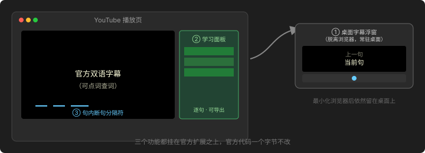
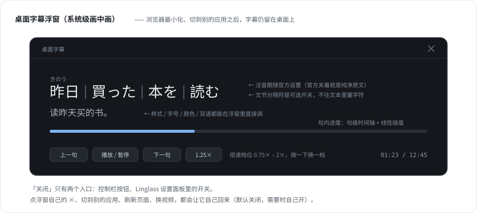
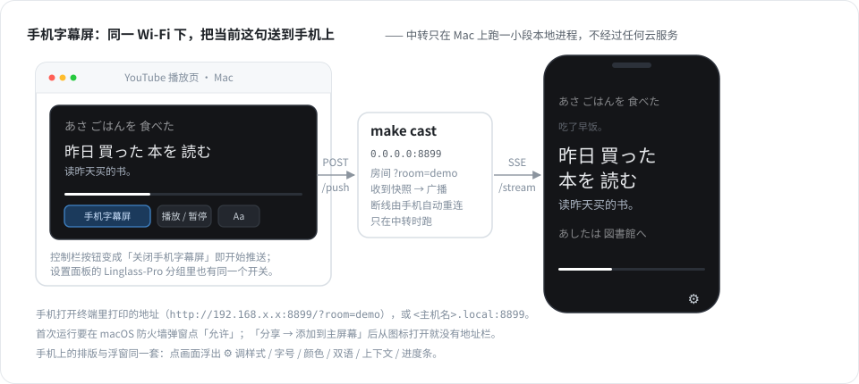
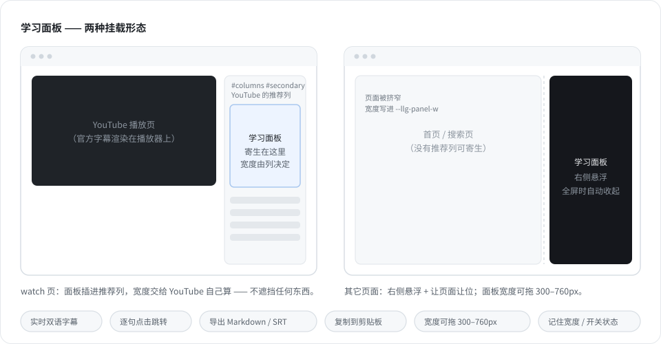
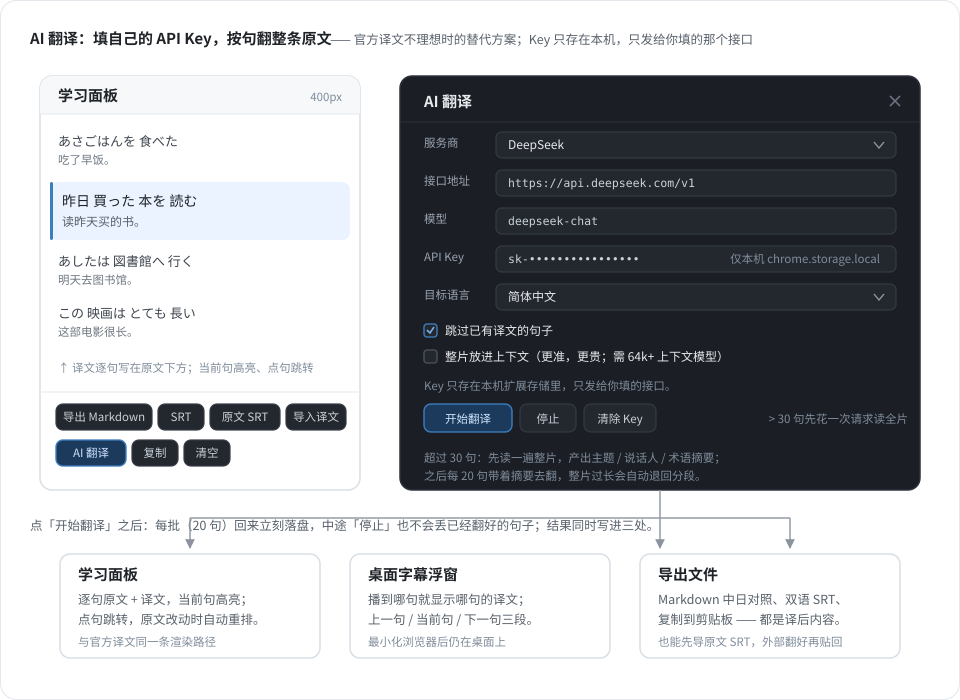
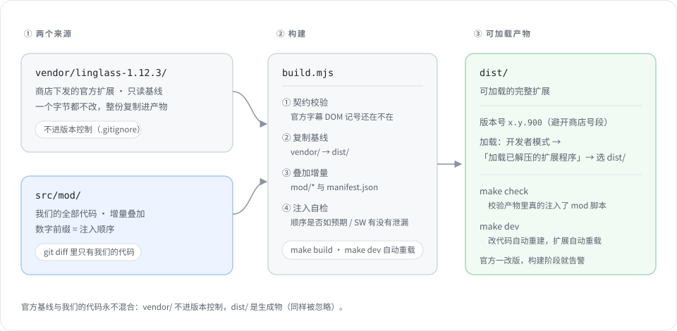
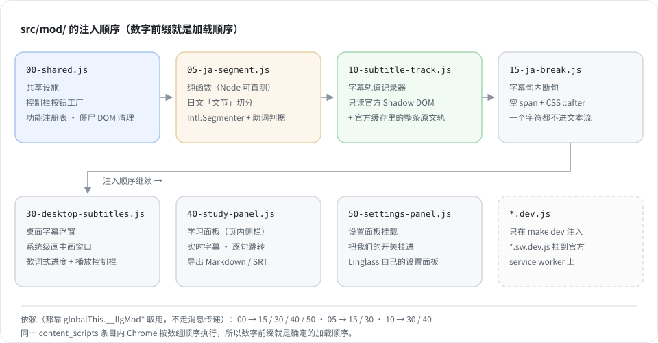

# Linglass-Pro

在 [Linglass](https://chromewebstore.google.com/detail/nhncklckpmkkhjcijjgfcgclfpbbkcba)（YouTube 双语字幕扩展）之上做**增量改造**：官方代码一个字节都不改，构建时叠加成一个新扩展。



| 功能 | 一句话说明 | 默认 |
| --- | --- | --- |
| 🖥️ 桌面字幕浮窗 | 把字幕投到系统级画中画窗口，最小化浏览器也看得见 | 关闭，手动点开 |
| 📱 手机字幕屏 | 同一 Wi-Fi 下用手机全屏看字幕，不用凑在电脑前 | 关闭，点按钮开 |
| 📋 学习面板 | 侧栏显示整条字幕，点句跳转，能导出 Markdown / SRT | 常驻 |
| ✂️ 句内断句 | 日语字幕按「文节」断开，方便跟读 | 跟随设置 |
| 🤖 AI 翻译 | 填自己的 API Key，按句翻译原文，结果直接进面板/浮窗/导出 | 关闭，按需开 |

以上开关都挂在 **Linglass 自己的设置面板**（`Linglass-Pro` 分组）里，不是额外的悬浮按钮。

---

## 🖥️ 桌面字幕浮窗



- 字幕区是「上一句 / 当前句 / 下一句」三段，当前句最亮，上下文淡一些。
- 控制栏上方有一条**整片进度条**：白色已播放段 + 悬停变粗，点一下或拖动即可跳到对应位置（直播等时长未知的情况不跳）。
- 控制栏右端 `Aa` 打开**整页设置面板**：根页（语言 / 总开关 / 双语 / 读音 / 配图）、外观页（预设 / 字号 / 颜色）、观看模式页，外加末尾的 `Linglass-Pro` 分组（我们自己的开关与动作）。样式直接从官方设置面板实时拷贝，观感一致；改动写回 Linglass 的同一份设置，页面内字幕同步变化。
- **默认关闭，手动打开**：只有控制栏的「桌面字幕」按钮或设置面板里的开关会弹出它；
  点视频、点播放器、点页面任意处都不会自动弹。
- **开了就一直开着**：点浮窗自己的 `×`、刷新页面、换视频都会自动重开；只有设置面板的开关能真正关掉它。
- 播到哪一句，译文才会出现在哪一句（官方不缓存整条译文），这是官方数据本身的限制。
- 更多细节（进度驱动方式、窗口尺寸规则、注音跟随逻辑）见下方「已知限制」。

## 📱 手机字幕屏



把正在播的这一句同步到手机上，手机全屏看字幕，不用凑在电脑前。

```bash
make cast        # 启动局域网中转（默认 8899），终端会打印手机要打开的地址
make cast-demo   # 没有视频时用假字幕预览手机端排版
```

1. 手机与 Mac 连**同一个 Wi-Fi**，用手机浏览器打开终端里那一行
   `http://192.168.x.x:8899/?room=demo`（或 `http://<主机名>.local:8899/?room=demo`）。
   首次运行要在 macOS 的防火墙弹窗里点「允许」。
2. 在 YouTube 播放页点控制栏的 **手机字幕屏** 按钮；它变成「关闭手机字幕屏」即开始推送。
   设置面板的 `Linglass-Pro` 分组里也有同一个开关，以及一行「测试手机字幕屏连接」。
3. 手机上的排版与浮窗同一套：上一句 / 当前句 / 下一句、文节分隔、注音、双语；
   底部是整片进度条 + **常驻**的播放控制条（`−5s` / 播放暂停 / `+5s` / 倍速），
   右上角 `⚙` 改样式 / 字号 / 颜色 / 双语 / 上下文 / 进度条。
   「分享 → 添加到主屏幕」之后从图标打开就没有地址栏（iOS 只有 standalone 模式能全屏）。
4. **上滑字幕区**可以按句回看：滑得越远翻得越多，浮层中间那行就是将要跳到的句子；
   松手后 Mac 上的播放器跳到该句开头。往下滑则是往更晚的句子走。

- 推送走 SSE（服务端 → 手机），手机断线会自动重连；Mac 那边暂停且字幕没变时不会重复发。
- 播放控制是**反向**的：手机把命令发给中转站，扩展在下一拍推送的响应里取走并操作 Mac 上的 `video`。
  所以暂停时也会每秒发一次空推送 —— 那是命令的回程通道。
- 房间号（`?room=`）只用于隔离多台手机 / 多个标签，**不做鉴权**：同一 Wi-Fi 上打开这个地址的人都能看到字幕。
- 换端口：`PORT=9000 node tools/cast-server.mjs`，扩展侧的 `endpoint` 也要跟着改（`__llgModCast.setConfig`）。
- 改了中转站或接收页的代码后要**重启 `make cast`**：页面是每次请求现生成的，但进程里跑的是启动时加载的模块。
  手机上也要重新加载页面（SSE 断线重连不会重新拉 HTML）。

## 📋 学习面板



- 在视频播放页插进 YouTube 自己的推荐列，不遮挡任何东西；其它页面退回右侧悬浮。
- 宽度可拖（300–760px），关闭状态会记住。
- 实时双语字幕、当前句高亮、逐句点击跳转、导出中日对照 Markdown / 双语 SRT / 复制剪贴板。

## 🤖 AI 翻译（用自己的 API Key）



官方译文不理想时，可以换成自己的模型翻：

- 学习面板页脚 → `AI 翻译`（设置面板里也有一行同样的入口）。
- 填服务商（DeepSeek / OpenAI / Kimi / SiliconFlow / OpenRouter / 自定义）、接口地址、
  模型、目标语言，Key 只存在本机 `chrome.storage.local`，只发给你填的那个接口。
- 默认**只翻还没有译文的句子**：重复点不会把已经翻好（或手工导入 SRT）的内容整片重翻、覆盖，
  也就不会白白烧额度；想强制重翻就在面板上取消「跳过已有译文」。
- 点「开始翻译」后：超过 30 句会先花一次请求把**整片**读一遍，产出主题/说话人/术语译法摘要；
  之后每段（20 句）都带着这份摘要 + 前面最多 3000 字的原文窗口一起翻，
  结果直接写进面板、浮窗与导出文件；中途可以「停止」，已经翻好的句子不会丢。
- 勾「整片放进上下文」后，**每条请求都带全片编号原文**，只要求翻当前 20 条（更准、更贵）；
  整片超过 3 万字或模型上下文不够时会自动退回分段，不会卡死。
- 接口要是 OpenAI 兼容的 `/chat/completions`；地址填 `https://api.deepseek.com/v1` 这种就够，
  完整的 `.../v1/chat/completions` 也认。自定义网关需要允许浏览器直连（CORS），
  否则会提示「连不上接口」。

## ✂️ 字幕句内断句

```text
私は|昨日|図書館で|日本語の|本を|借りました。|
```

- 分隔符只是一个空 `span` 的 CSS `::after`，**不进文本流**，官方的点词查词、拖拽选词完全不受影响。
- 切分规则见 [`docs/plans/020-ja-segment-rules.md`](docs/plans/020-ja-segment-rules.md)。

---

## 装好后需要登录

官方扩展**登录之后才翻译**——没有字幕数据，浮窗和面板都用不了。支持 Google / Apple 登录，也支持邮箱注册。**Google 登录在部分网络下打不开**，遇到这种情况直接用邮箱注册一个账号即可。

## 只想装上用（不写代码）

**公开下载只有安装器版**，不含任何 Linglass 官方代码：

1. 装 Node.js 18+（[nodejs.org](https://nodejs.org)）
2. 下载 `Linglass-Pro-<版本>-installer.zip`，解压
3. 双击 `install-macos.command`（Windows 双击 `install-windows.bat`；macOS 首次需右键 → 打开）
4. 脚本会从 Chrome 商店下载官方 Linglass 基线到**你本机**的 `vendor/`，再叠加本项目改动生成 `dist/`
5. 扩展管理页 → 开发者模式 → 加载已解压的扩展程序 → 选 `dist/` 目录

包里带一份图文向导（[`docs/install-guide.html`](docs/install-guide.html)），装不上时先看它。

> ⚠️ **版权与分发边界**
>
> - 本仓库和公开 release **不包含、也不提供** Linglass 官方代码的下载。
> - 安装器版里的官方代码是**用户本机在安装时自己从 Chrome 商店拉取**的，获取行为发生在用户与商店之间。
> - 请勿把 `vendor/`、`dist/` 或任何含官方代码的打包产物上传到 GitHub Release、公开网盘、论坛、应用商店等公共渠道。

### 自用完整包（不对外分发）

`make package` 仍会同时产出完整版，但它含官方代码，**只供本人或小范围私下使用**：

```bash
make package
# → release/Linglass-Pro-<版本>-extension.zip   完整版，解压即用，内含官方代码
# → release/Linglass-Pro-<版本>-installer.zip   安装器版，可公开分发
```

完整版不要上传到任何公开渠道；需要给别人用就发安装器版。

## 起步（开发）

```bash
make vendor-update   # 下载官方基线到 vendor/，然后构建
make open            # 打开浏览器扩展管理页
```

在扩展管理页打开开发者模式 → 加载已解压的扩展程序 → 选 `dist/` 目录。日常开发用 `make dev`：改完自动重建并重载扩展。

`vendor/` 不进版本控制（官方专有代码，只读基线），第一次使用必须先跑一次 `make vendor-update`。

## 日常命令

| 命令 | 作用 |
| --- | --- |
| `make help` | 列出全部命令 |
| `make build` | 构建 `dist/` |
| `make dev` | 监听源码，自动重建并让扩展自动重载 |
| `make test` | 跑契约测试与逻辑冒烟测试 |
| `make check` | 自检 `dist/` 是否已正确注入 |
| `make probe` | 开一个带扩展的浏览器做实测 |
| `make cast` | 启动手机字幕屏的局域网中转（默认 8899） |
| `make cast-demo` | 同上，但用假字幕预览手机端排版 |
| `make open` | 打开扩展管理页 |
| `make package` | 打两个包到 `release/` |
| `make vendor-update` | 拉取官方最新版作为基线并重新构建 |
| `make clean` | 删除 `dist/` |

## 工作原理



**只读基线 + 增量叠加**：官方产物在 `vendor/`（只读），我们的代码在 `src/mod/`，构建时叠加成 `dist/`。官方发新版只需换 `vendor/`；`git diff` 里永远不会出现官方代码。



数字前缀决定注入顺序，模块之间通过 `globalThis.__llgMod*` 直接取用，不走消息传递：

| 文件名 | 作用 |
| --- | --- |
| `00-shared.js` | 共享设施：按钮工厂、功能注册表、共享心跳、僵尸 DOM 清理 |
| `05-ja-segment.js` | 纯函数：把日文切成「文节」 |
| `05-srt.js` | 纯函数：SRT 解析、译文贴回计划 |
| `06-ai-translate.js` | 纯函数：AI 翻译的切批、prompt、返回解析 |
| `10-subtitle-track.js` | 字幕轨道记录器 |
| `12-longline.js` | 长句排版：放宽官方字幕行宽度、按日文禁则断行 |
| `15-ja-break.js` | 字幕句内断句 |
| `30-desktop-subtitles.js` | 桌面字幕浮窗 |
| `35-cast.js` | 手机字幕屏的发送端（控制栏按钮 + 推送） |
| `35-cast.sw.js` | Service Worker 侧的转发（只挂 SW，绝不当内容脚本） |
| `40-study-panel.js` | 学习面板 |
| `50-settings-panel.js` | 挂进 Linglass 自己的设置面板 |

省资源靠三条硬约束：所有模块共用 `00-shared.js` 里**同一个** 1s 定时器；每帧 rAF 循环不碰 Shadow DOM（答案由 MutationObserver 缓存）；落盘有上限（每个视频最多 5000 句，最多留 30 个视频 / 30 天）。

## 验证方式

`make test` 当前 **168 例全绿**（零依赖，`node --test`）：

- **契约测试**：断言对官方 DOM / YouTube 平台的依赖仍然成立，新增依赖必须登记。
- **冒烟测试**：`node:vm` 沙箱里把 `src/mod/*.js` 原封不动跑起来。
- **断句 / 工具链测试**：断句切点、zip 往返、安装器、打包结构。

浏览器内的视觉与交互（面板滑入、浮窗是否真的留在桌面）Node 测不了，属于人工确认范围，`make probe` 可以半自动跑一部分。

## 已知限制

- 目前只支持 YouTube，且需要登录（见上文）。
- 字幕的句子与时间戳来自官方缓存的原文轨；**译文只在实际播放过才有**。
- 注音（振假名）只在浮窗跟随官方显示，面板与导出文件不含注音。
- 浮窗高度随内容定，字号变化不会自动重算窗口大小，拖一下即可。
- 词级时间戳拿不到（官方不暴露内部 cue 时间轴），词内进度是线性插值近似。
- 手机字幕屏要在 Mac 上跑 `make cast`，只传字幕、不传画面与声音；Mac 页面关掉就没有内容了。
- 手机上的播放控制与上滑选句跳转都要靠 Mac 上那个标签页里的扩展去执行，所以那个页面不能关。
- 手机字幕屏走局域网 HTTP，没有鉴权：同一 Wi-Fi 上知道地址的人都能看。
- 公开分发只有安装器版，所以对方必须先装 Node；想做成「免 Node 的干净包」就得随包附带官方代码，那是再分发，不做。取舍见 [`docs/plans/023-one-click-installer.md`](docs/plans/023-one-click-installer.md)。
- 官方发新版不会自动同步，需要重新跑一次安装流程。

## 目录结构

```text
Linglass-Pro/
├── AGENTS.md               本仓库的 AI 行为约束（改代码前先读）
├── Makefile                门禁与日常命令
├── build.mjs               构建脚本
├── docs/
│   ├── images/             README 配图
│   ├── install-guide.html  图文安装向导
│   └── plans/NNN-*.md      一个需求一份 PLAN
├── src/mod/                我们的全部代码
├── tools/                  dev / import-vendor / install / package / probe / cast-server / cast-page / zip / test
├── vendor/                 官方基线（只读，不进版本控制）
├── release/                安装包产物（不进版本控制）
└── dist/                   构建产物（不进版本控制）
```

## 开发约定

- **改代码前先读 [`AGENTS.md`](AGENTS.md)**：一个需求一份 PLAN，PLAN 声明修改范围，越界要停下报告；`vendor/` 与 `dist/` 只读；Bug Fix 必须带回归测试。
- 需求与设计留档在 [`docs/plans/`](docs/plans)，编号连续递增。
- 提交前跑门禁（改 `src/mod/**` 就 `make build` + `make test` + `make check`），用 `git diff --stat` 核对改动量级。
- 全仓库零第三方依赖。
